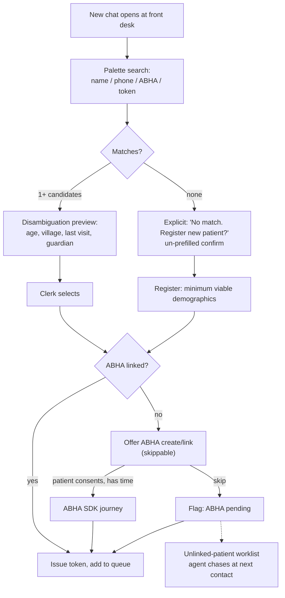
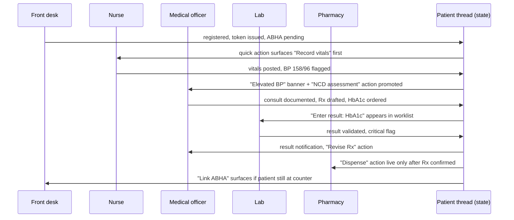

# Agentic EMR: Role Modules and Station Handoff — Addendum to Scope v0.1

**Status:** draft, extends Product Scope v0.1 §3, §5, §6
**Purpose:** specifies what each cadre's module contains, how a patient's state moves between them, and the permission primitive underneath.

---

## A. Input modality doctrine

The single most consequential decision in the module design is which input instrument each station uses. Getting this wrong is not a UX defect — it writes bad numbers into the clinical record and into the district dashboard.

**The rule: scribe captures narrative, forms and devices capture discrete values.**

Narrative prose is redundant. If ASR drops or substitutes a word in a history, context usually recovers it and the clinician catches it on review. A discrete value has no redundancy: "one forty over ninety" misheard as "one fourteen over ninety" is a silent, plausible, unrecoverable error that propagates into the NCD registry and is acted on at district review.

The evidence is not marginal:

- Unedited speech-recognition clinical documents show roughly a 7.4% error rate, with deletions (34.7%) and insertions (27%) the dominant failure modes and 5.7% of errors clinically significant (*JAMA Netw Open*, 2018, n=217 notes).
- A 2026 scoping review of 32 studies found accuracy varied markedly by setting, with substantially higher error rates in emergency, psychiatric and **nursing** contexts, and misrecognition of brief utterances a common failure.
- In an emergency department, 71% of speech-recognised notes contained at least one error and 15% contained a critical one.
- Second-language English speakers generated significantly more errors in a multilingual hospital study — directly relevant to PHC staff across our target states.

Brief utterances and numerics are precisely the payload of the vitals and lab stations. Assigning ambient scribe there maximises exposure to the failure mode with the least tolerance for it.

### Three instruments

| Instrument | Use for | Confirmation |
|---|---|---|
| **Ambient scribe** | Consultation narrative, FLW visit conversation, assessment free-text | Draft payload, rendered for edit and confirm |
| **Constrained voice** | Numeric fields where hands are busy | Grammar-restricted number capture, **mandatory on-screen readback before commit**, no free speech |
| **Form / device** | Vitals, lab results, stock counts, anything with a range check | Direct entry with validation; device feed where available |

Constrained voice is not scribe. It accepts a bounded grammar ("systolic one forty", "weight sixty two point five"), displays the parsed value, and requires a tap to commit. It fails closed to the numeric keypad.

### Revised module table

| Cadre | Module contents | Input instrument | Notes |
|---|---|---|---|
| **Front desk** | Find patient, register, ABHA link, collect additional demographics, queue token | Form + palette search | ABHA SDK is **not** auto-initiated. See §B. |
| **Nurse** | Vitals, triage, allergy check, pre-consult flags | **Form or connected device**, constrained voice as accelerator | Not ambient scribe. BP, SpO2, glucometer, weight feed directly where hardware exists. |
| **Medical officer** | Consultation, prescription, referral, lab order, follow-up | **Scribe** (narrative) + form (Rx, orders) + assistant (chat) | Scribe output is a draft payload into the Rx form, never a commit. |
| **Lab technician** | Sample accession, result entry, validation | **Analyser feed or LIS import**; form for manual bench tests | Re-keying results is an error source and the data is already digital upstream. Scribe is not appropriate here. |
| **Pharmacist** | Dispense against Rx, substitution, stock decrement, counselling note | Form (dispense) + scribe (counselling note only) | Added — missing from earlier draft, present in v0.1 §3. |
| **FLW (ASHA / ANM / CHO)** | Household visit, registration, assessment instruments, appointment request, follow-up capture | **Scribe** (visit conversation) + form (assessment items) | Offline-first. Assessment scoring is deterministic, never model-generated. |

**Where manual lab entry is unavoidable** (no analyser interface, bench tests, rural labs): use a form with per-analyte range validation and critical-value flagging, not dictation. A result outside physiological range blocks commit and requires explicit override with reason.

---

## B. Front desk flow: find first, create on miss

Auto-initiating the ABHA SDK on every new chat makes *create* the default path and *search* the exception the clerk has to remember. In an OPD where most footfall is repeat patients, that reliably manufactures duplicate patient records and duplicate ABHAs. Per v0.1 §5, ABHA creation and care-context linking are irreversible — a duplicate cannot be undone, only deprecated.

It is also a queue-blocker. The ABHA journey involves OTP round trips the patient may fail at the counter while twenty people wait.

**Rules.**

1. **Search is the default surface.** The chat opens on the palette, not on a registration form.
2. **Creation requires an explicit, un-prefilled confirm.** Per v0.1 §5 this is the irreversibility class — the confirm cannot be pre-checked or defaulted.
3. **Register-now-link-later is a first-class path.** A patient without an ABHA is registered, tokened, and seen. The ABHA gap becomes a worklist item, not a barrier to care.
4. **The unlinked worklist is agent-owned.** Between consultations, or at next contact, the agent surfaces "link ABHA" as a quick action for whoever is free. This turns v0.1's ABDM burden into background work rather than a cost the doctor's queue absorbs.
5. **Additional demographic forms are conditional, not routine.** A configured form appears only when the encounter type or programme requires fields the base registration lacks (e.g. ANC registration needs LMP). The condition lives in the operation registry.

**Duplicate defence.** Search must be tolerant of the actual mess: transliteration variants, no fixed surname order, shared household phone numbers, approximate ages. Match on phone + partial name + age band before offering create, and show any near-miss candidates *on the same screen* as the create confirm so the clerk sees what they are about to duplicate.

---

## C. Capability model and scopes

**The problem with personas.** Many sub-centres and PHCs have no front-desk clerk and no lab technician. A CHO registers, takes vitals, runs the assessment, and dispenses. If modules are hard-coded personas, those facilities either cannot use the system or everyone is granted "doctor" — which is the outcome that quietly destroys the permission model.

**The primitive is a capability, assigned to a person. Bundles are defaults, not walls.**

### Capabilities

| Capability | Grants |
|---|---|
| `patient.find` | Search and open any patient in the facility |
| `patient.register` | Create patient record, edit demographics |
| `abha.link` | Initiate ABHA create/link, care-context linking |
| `vitals.record` | Write vitals, triage category |
| `assessment.record` | Administer and record approved assessment instruments |
| `encounter.document` | Write consultation narrative, diagnosis |
| `rx.prescribe` | Create prescription |
| `lab.order` | Order investigations |
| `lab.result.enter` | Enter results |
| `lab.result.validate` | Sign off / release results |
| `pharmacy.dispense` | Dispense against Rx, decrement stock |
| `visit.household` | Record household/outreach visit |
| `appointment.book` | Book into facility slots |
| `facility.admin` | Assign bundles, configure quick actions, manage stock |
| `reporting.view` | Facility dashboards |

### Default bundles

| Bundle | Capabilities |
|---|---|
| Front desk | `patient.find`, `patient.register`, `abha.link`, `appointment.book` |
| Nurse | Front desk + `vitals.record`, `assessment.record` |
| Medical officer | `patient.find`, `encounter.document`, `rx.prescribe`, `lab.order`, `assessment.record`, `reporting.view` |
| Lab technician | `patient.find`, `lab.result.enter` |
| Lab in-charge | Lab technician + `lab.result.validate` |
| Pharmacist | `patient.find`, `pharmacy.dispense` |
| FLW (ASHA) | `patient.find`, `patient.register`, `abha.link`, `visit.household`, `assessment.record`, `appointment.book` |
| ANM | ASHA + `vitals.record` |
| CHO | ANM + `encounter.document`, `lab.order`, protocol-bound subset of `rx.prescribe` |

A person holds one or more bundles plus individually granted capabilities. A single nurse at a sub-centre may hold Nurse + Pharmacist + Lab technician. That is a real configuration, not an edge case.

### Replacing "master access"

The MO does **not** get master access. Master access contradicts v0.1 §6's own position that permissions are the product, and it is wrong clinically: an MO should not be signing off lab results, dispensing from pharmacy stock, or editing an ASHA's household visit record.

What the MO actually needs:

- **Broad read** across the full patient record — every station's output, every prior encounter, ABDM-fetched external records. Read scope is the widest of any cadre and should be stated as such.
- **Write confined to their clinical scope** — documentation, prescription, orders, referral.
- **No write** on `lab.result.validate`, `pharmacy.dispense`, `patient.register` (correction requests instead of direct edits), or another cadre's completed records.

Corrections across scope boundaries go through an **amendment request**: the MO flags a value as wrong, the owning role sees it in their worklist, the original value is retained with the amendment appended. Never a silent overwrite. This preserves the audit trail v0.1 §4 depends on and gives a real answer to "who entered this."

**Scope-of-practice guard.** The `rx.prescribe` capability for a CHO is not the same as for an MO — it is bounded to an approved formulary and protocol set. Model this as a **scope qualifier** on the capability, not a separate capability, so the guard in v0.1 §4 evaluates one thing. This is v0.1 open decision 5 and needs a named clinical signatory before Phase 3.

---

## D. Station handoff: the thread is the baton

Modules as currently drafted are five stations with nothing carrying state between them. Without a baton, each module is a separate app sharing a database, and the patient's context is re-established from scratch five times.

**The patient thread carries the state.** Each confirmed operation updates patient state; state drives the next station's quick actions. This is what makes per-role modules a workflow rather than a menu.

### State-driven quick actions

Quick actions are **ordered by patient state, not configured per user**. Facility admin sets the available set per bundle; the agent orders them. Hard cap of six visible actions; the rest live behind the palette.

| Patient state | Front desk | Nurse | MO | Lab | Pharmacy |
|---|---|---|---|---|---|
| Registered, no vitals | Link ABHA · Print token | **Record vitals** | Start consult (with "vitals pending" flag) | — | — |
| Vitals abnormal | — | Re-check · Escalate | **Review flagged vitals** · Start consult | — | — |
| Consult in progress | — | — | **Scribe** · Write Rx · Order lab · Refer | — | — |
| Lab ordered | — | — | View pending | **Enter result** | — |
| Result critical | — | — | **Review critical result** | Validate | — |
| Rx confirmed | — | — | — | — | **Dispense** · Substitute |
| Rx dispensed, follow-up due | Book follow-up | — | — | — | — |
| ABHA pending, patient present | **Link ABHA** | Link ABHA | — | — | Link ABHA |

**Design constraints.**

1. **No action appears before its precondition.** `pharmacy.dispense` is not visible until a prescription is confirmed. This is enforced in the operation registry, not in the UI — per v0.1 §4, the guard must hold identically whether invoked from the rendered surface or the agent.
2. **Ordering is deterministic, not generated.** The rules above are a table, not a model output. The agent may *explain* the ordering; it does not decide it. A generated action order is untestable and unauditable.
3. **State transitions are the audit events.** Each row of §D's table corresponds to a posted operation with actor, surface, payload and outcome.
4. **Offline degrades to the static bundle order.** Per v0.1 §7, when disconnected the FLW surface shows the bundle's default action list with no state-driven promotion.

**Handoff at facilities without stations.** Where one person holds three bundles, the thread still tracks state — the same person sees "Record vitals" then "Start consult" in sequence rather than a flat menu of everything they are permitted to do. The baton model gets *more* valuable in thin-staffed settings, not less.

---

## E. Remaining gaps

### E.1 Pharmacist module

Absent from the earlier module list, present in v0.1 §3. Scope for v1:

- **Dispense against a confirmed Rx.** Form-based, quantity and batch captured, stock decremented atomically. Partial dispense supported — PHC stockouts are routine and the record must show what the patient actually received, not what was prescribed.
- **Substitution** within an approved generic-equivalence list, with the reason recorded and the prescribing MO notified in the thread. Free substitution is out of scope.
- **Counselling note** — the one place scribe is appropriate in this module, as narrative.
- **Stock visibility upward.** Dispense events feed facility stock, which feeds the MO's prescribing surface: an out-of-stock drug should be visible at the point of prescribing, not discovered at the counter. This is the highest-value cross-station signal in the whole design and costs little.

### E.2 Assessment instruments

"Takes assessments" needs a named scope or the protocol-bound content library (v0.1 §2, §6) has no boundary. Proposed v1 set, all deterministic scoring, all mapped to existing programme instruments so output can write back to state systems:

| Instrument | Cadre | Notes |
|---|---|---|
| **CBAC** (Community Based Assessment Checklist) | ASHA, ANM, CHO | NCD risk. Already the mandated instrument; write-back to NCD portal is the displacement argument in v0.1 §9. |
| **ANC visit schedule** | ASHA, ANM | Maps to RCH. Danger-sign checklist is protocol-bound. |
| **Immunisation due-list** | ASHA, ANM | Maps to U-WIN. |
| **TB symptom screen** | ASHA, CHO | Maps to Ni-Kshay referral. |
| **NCD follow-up** (BP/glucose control review) | ANM, CHO, MO | The workflow named in v0.1's success test. |

**Constraints.** Scoring is computed by rule, never by the model. The agent may prompt the next question and transcribe the answer; it does not decide the score or the referral threshold. Any guidance shown to an FLW comes from the approved library with a visible source, per v0.1 §2.

**Open:** each instrument needs a named clinical owner and a version, because instruments change with programme guidelines and a stale CBAC in the field is a compliance failure.

### E.3 Consent

Ambient capture at five stations multiplies the consent surface. Five prompts per visit is both a UX failure and, in practice, consent theatre.

**Single visit-scoped consent, captured once at registration.**

- Captured at the front desk as part of the token flow, in the local language, plain-worded: what is recorded, who can see it, how long it is kept, how to decline.
- **Declining is not a barrier to care.** A patient who declines audio is seen normally; every station falls back to form entry. This must be true and visible, or consent is not meaningful.
- **Scope:** the visit, not the patient. It does not persist to the next visit. Household visits by an FLW take their own consent at the door.
- **Audio retention is separate from record retention.** Default: audio is deleted once the derived payload is confirmed, with a short grace window for correction. Retaining raw consultation audio indefinitely is a DPDP liability with no clinical benefit.
- **Visible indicator** at every station when capture is live. Not a setting buried in a menu.
- **Withdrawal** mid-visit stops capture and discards audio from that point; already-confirmed records stand.

This needs review against DPDP rules as they stand at build time and against the ABDM consent framework, which is a separate mechanism governing record *sharing* — do not conflate the two. Ambient-capture consent is not ABDM consent and the two should not share a screen.

---

## F. Open decisions added by this addendum

1. **Device integration scope for vitals.** Which BP monitors, glucometers and weighing scales are in scope for direct feed in v1, and what the manual-entry fallback validation looks like where there is no hardware.
2. **LIS/analyser interface reality per site.** How many target facilities have an analyser that can be interfaced at all. If the honest answer is "few," manual result entry with range validation is the v1 path and the LIS story is Phase 5.
3. **Amendment request SLA.** Who is accountable when an MO flags a nurse's vitals as wrong and nobody actions it.
4. **Assessment instrument versioning and clinical ownership** (extends v0.1 open decision 5).
5. **Audio retention window** — needs a number, and it should be short.
